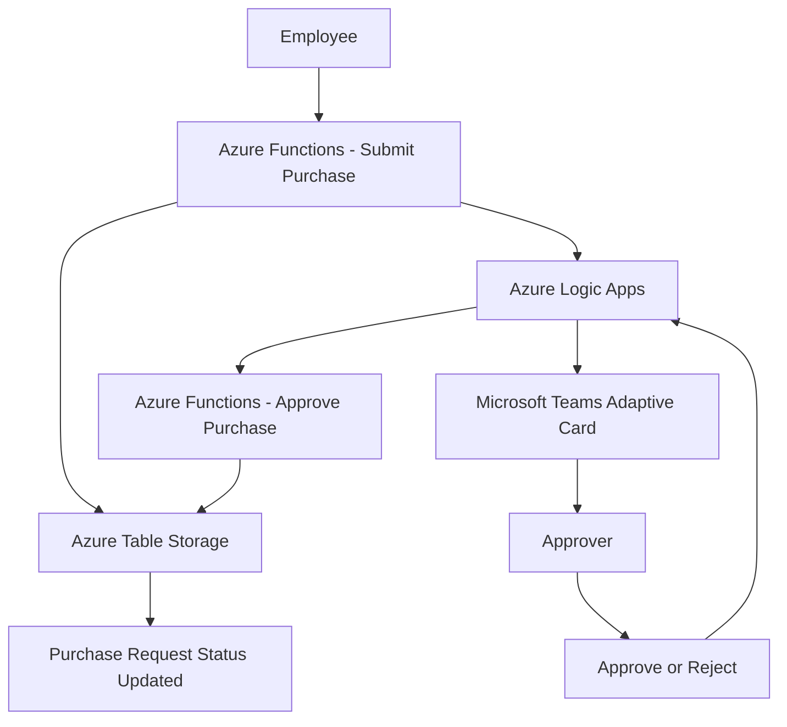

# Azure Employee Purchase Approval Workflow

A serverless employee purchase approval system built using Microsoft Azure. The application allows employees to submit purchase requests, stores request information in Azure Table Storage, and sends approval notifications through Microsoft Teams.

## Project Overview

This project demonstrates how cloud services can be integrated to automate a business approval process.

Employees submit purchase requests through an HTTP API. The request is stored in Azure Table Storage with a Pending status. Azure Logic Apps sends an adaptive card to Microsoft Teams, where an approver can approve or reject the request. Azure Functions then updates the request status.

## Architecture



## Technologies Used

| Technology | Purpose |
|---|---|
| Azure Functions | Serverless backend and HTTP APIs |
| Python | Backend application development |
| Azure Table Storage | Store employee purchase requests |
| Azure Logic Apps | Automate approval workflow |
| Microsoft Teams | Interactive approval notifications |
| GitHub | Source code management |
| GitHub Actions | Continuous Integration and Continuous Deployment |
| Azure Managed Identity / OIDC | Secure GitHub Actions authentication |

## Main Features

- Submit employee purchase requests.
- Automatically generate unique request IDs.
- Store purchase information in Azure Table Storage.
- Retrieve existing purchase requests through an HTTP GET API.
- Send approval notifications to Microsoft Teams.
- Approve or reject purchase requests.
- Automatically update request status.
- Deploy application updates using GitHub Actions.

## Azure Functions

The application contains three HTTP-triggered functions.

| Function | Method | Description |
|---|---|---|
| submit_purchase | POST | Creates a new purchase request |
| get_purchase_requests | GET | Retrieves purchase requests |
| approve_purchase | POST | Updates a request to Approved or Rejected |

## Approval Workflow

1. An employee submits a purchase request.
2. Azure Functions validates the request.
3. The request is saved in Azure Table Storage with Pending status.
4. Azure Logic Apps initiates the approval process.
5. Microsoft Teams sends an interactive approval card.
6. The approver selects Approve or Reject.
7. Azure Functions updates the request status.
8. The updated status is stored in Azure Table Storage.

## CI/CD Pipeline

GitHub Actions automates application deployment.

Whenever code is pushed to the `main` branch:

1. GitHub checks out the repository.
2. Python dependencies are installed.
3. The application package is prepared.
4. GitHub authenticates with Azure using OpenID Connect (OIDC).
5. The application is deployed to Azure Functions.

This removes the need for manual deployment after every code update.

## Project Structure

```text
azure-employee-approval-workflow/
│
├── .github/
│   └── workflows/
│       └── main.yml
│
├── function_app.py
├── host.json
├── requirements.txt
├── .funcignore
└── .gitignore
```

## Security

- Sensitive configuration values are stored in Azure Function App settings.
- Local configuration files are excluded from Git.
- Virtual environments are excluded from version control.
- GitHub Actions uses OIDC authentication instead of storing Azure client secrets.
- Function keys and connection strings must remain private.

## Testing

The application was tested by:

- Submitting purchase requests through the deployed HTTP API.
- Retrieving records from Azure Table Storage.
- Sending approval notifications through Microsoft Teams.
- Testing both approval and rejection decisions.
- Verifying updated request statuses.
- Running the GitHub Actions deployment pipeline successfully.

## Learning Outcomes

Through this project, I gained practical experience with:

- Serverless application development.
- Azure Functions and Python.
- Cloud storage and data management.
- Workflow automation.
- Microsoft Teams integrations.
- CI/CD implementation.
- GitHub Actions.
- Secure cloud authentication using OIDC.

## Author

**Sethumadhavan Abimannan**

Software Engineering Student | Cloud Computing & Cloud Security Enthusiast

GitHub: https://github.com/sethumadhavan-abimannan0509

---

*This project was developed as a hands-on learning project to explore Microsoft Azure services, serverless architecture and cloud automation.*
